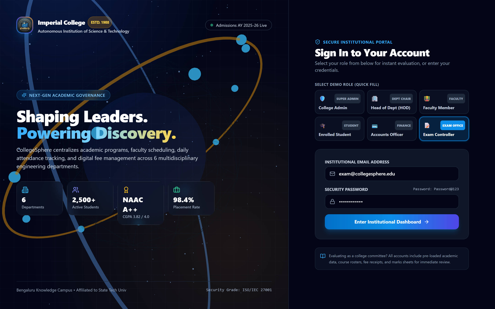
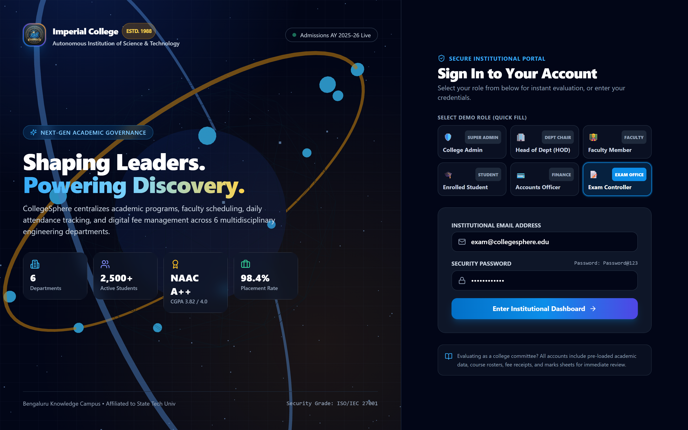

<div align="center">


# CollegeSphere

**An institutional-grade, multi-role web platform designed to streamline and govern academic, administrative, and financial operations in higher education.**

[](https://frontend-weld-ten-61.vercel.app)
[](https://backend-tau-green-93.vercel.app/api/v1/health)
[](LICENSE)

<br/>



</div>

---

## 📑 Table of Contents
- [About](#about)
- [Features](#features)
- [Demo](#demo)
- [Getting Started](#getting-started)
  - [Prerequisites](#prerequisites)
  - [Installation](#installation)
  - [Running the Project](#running-the-project)
- [Usage](#usage)
- [Project Structure](#project-structure)
- [Configuration](#configuration)
- [Contributing](#contributing)
- [License](#license)
- [Contact](#contact)

---

## 🏛️ About

**CollegeSphere** solves the fragmentation of higher education operations by uniting student records, faculty workloads, daily attendance rosters, examination assessments, and institutional fee ledgers into a single, cohesive governance portal.

Built with a **security-first, auditable, and serverless-compatible architecture**, CollegeSphere features an interactive **3D WebGL Canvas scene** (powered by Three.js), glassmorphic perspective cards, and immutable compliance audit logs. It supports single-institution deployments with native multi-tenancy readiness.

---

## ✨ Features

- **🪐 Interactive 3D WebGL Experience**: Built using Three.js with an interactive knowledge core, orbital rings, rotating departmental satellites, and mouse-reactive particle clouds.
- **🛡️ Strict Role-Based Access Control (RBAC)**: Fine-grained permission boundaries for 6 roles: Super Admin, Head of Department (HOD), Faculty Member, Enrolled Student, Accounts Officer, and Examination Controller.
- **🎓 Student Information System (SIS)**: Centralized student lifecycle directory with roll number indexing, admissions workflows, guardian records, and demographic profiling.
- **📅 Roster-Based Attendance Management**: Real-time session creator with instant roster marking (Present, Absent, Late, Excused) and audit-logged correction histories.
- **📝 Examinations & Grade Verification**: Exam scheduling, bounds-checked marks entry, HOD audit verification, and tamper-resistant grade publication.
- **💳 Fee Management & Receipt Ledger**: Automated fee schedule assignment, partial payment recording, duplicate transaction rejection, and printable digital receipts.
- **📢 Institutional Circulars & Announcements**: Broadcast notifications scoped to specific departments or campus-wide audiences.
- **🔒 Immutable Audit Trail**: Cryptographically traceable compliance logging for all academic, admission, and financial state changes.

---

## 🚀 Demo

### Live Application Screenshots (Captured from Running Project)

<div align="center">

#### 1. Interactive 3D Authentication Portal & Multi-Role Selector


#### 2. Institutional Governance Command & Analytics Dashboard


#### 3. Examination Management & Grade Verification Sheet


#### 4. Live Class Session Attendance & Roster Tracking


</div>

### Live Production Deployments
* **Web Application (SPA)**: [https://frontend-weld-ten-61.vercel.app](https://frontend-weld-ten-61.vercel.app)
* **REST API Endpoint**: [https://backend-tau-green-93.vercel.app/api/v1](https://backend-tau-green-93.vercel.app/api/v1)
* **Health Check**: [https://backend-tau-green-93.vercel.app/api/v1/health](https://backend-tau-green-93.vercel.app/api/v1/health)

### Quick-Fill Demo Credentials (Password: `Password@123`)
The login screen features one-click quick-fill buttons for all 6 roles:

| Role | Email | Purpose & Scope |
| :--- | :--- | :--- |
| **College Admin** | `admin@collegesphere.edu` | Full institutional oversight, staff & student CRUD, audit logs |
| **Head of Department (HOD)** | `hod.cse@collegesphere.edu` | Departmental courses, class offerings, mark approvals |
| **Faculty Member** | `faculty.cse@collegesphere.edu` | Course offerings, daily session attendance roster, draft marks |
| **Enrolled Student** | `student.arun@collegesphere.edu` | Student self-service: courses, attendance %, published grades, receipts |
| **Accounts Officer** | `accounts@collegesphere.edu` | Invoicing, fee payment recording, receipts, revenue reports |
| **Exam Controller** | `exam@collegesphere.edu` | Exam scheduling, mark sheets audit, official result publication |

---

## 🏁 Getting Started

### Prerequisites
* **Node.js**: v20+ or v24+ (`node -v`)
* **npm**: v10+ (`npm -v`)
* **MongoDB**: Local MongoDB 7+ / 8+ Community Edition (`mongod`) or a [MongoDB Atlas](https://www.mongodb.com/cloud/atlas) cluster URI
* **Python 3.x**: (Optional, for the bundled UI/UX Pro Max design intelligence script)

### Installation

1. **Clone the repository**:
   ```bash
   git clone https://github.com/vinoth1121/CollegeSphere-.git
   cd CollegeSphere-
   ```

2. **Install Backend Dependencies**:
   ```bash
   cd backend
   npm install
   ```

3. **Install Frontend Dependencies**:
   ```bash
   cd ../frontend
   npm install
   ```

### Running the Project

1. **Configure Environment Variables**:
   Copy `.env.example` into both `backend/.env` and `frontend/.env`.

2. **Seed the Database** (populates 6 departments, 5 faculty, 8 students, attendance, exams, fees):
   ```bash
   cd backend
   npm run seed
   ```

3. **Start the Backend API Server** (runs on `http://localhost:5000`):
   ```bash
   npm run dev
   ```

4. **Start the Frontend UI** (in a second terminal, runs on `http://localhost:5173`):
   ```bash
   cd ../frontend
   npm run dev
   ```

5. **Run the Automated Test Suite** (runs 6 test suites, 27/27 tests passed using in-memory MongoDB):
   ```bash
   cd ../backend
   npm test
   ```

---

## 💡 Usage

### Logging In & Switching Roles
1. Open [http://localhost:5173](http://localhost:5173) in your browser.
2. Click any of the **Quick-Fill Demo Credentials** buttons (e.g. *🛡️ College Admin* or *📝 Exam Controller*).
3. Click **Enter Institutional Dashboard**.

### Taking Attendance for a Class
1. Sign in as **Faculty Member** (`faculty.cse@collegesphere.edu`).
2. Navigate to **Class Attendance**.
3. Create a session for `CS501 - Database Management Systems`.
4. Mark students as **Present**, **Absent**, **Late**, or **Excused** and click **Submit Attendance**.

---

## 📂 Project Structure

```
CollegeSphere/
├── docs/                        # Architectural specifications & security documents
│   ├── access-control-matrix.md # Role-based permissions matrix
│   ├── architecture.md          # Multi-tier system topology
│   ├── database-design.md       # 22 collections data dictionary
│   ├── threat-model.md          # STRIDE threat model
│   └── deployment.md            # Vercel & Atlas deployment runbook
├── backend/                     # Node.js + Express + TypeScript REST API
│   ├── api/                     # Vercel Serverless Function entrypoint
│   ├── database/seed/           # Realistic synthetic institutional database seeder
│   ├── src/
│   │   ├── config/              # MongoDB connection & environment configuration
│   │   ├── controllers/         # REST request handlers
│   │   ├── middleware/          # JWT auth guard, RBAC, error sanitizer
│   │   ├── models/              # 22 Mongoose Schemas with compound indexes
│   │   ├── routes/              # Express API routing definitions
│   │   └── services/            # Transactional business logic & audit dispatchers
│   └── tests/                   # 27 Jest + Supertest integration tests
├── frontend/                    # React 18 + TypeScript + Vite + Tailwind SPA
│   ├── public/assets/           # 4K campus hero and 3D institutional emblem
│   └── src/
│       ├── components/          # ThreeCanvas 3D, Card3D tilt, Navbar, DataTable, Modal
│       ├── context/             # AuthContext with token retention
│       ├── pages/               # Multi-role dashboards and SIS operational views
│       └── services/            # Axios API client with 401 interceptors
├── .github/workflows/ci.yml     # Automated GitHub Actions CI pipeline
├── docker-compose.yml           # Unified local containerization
└── README.md
```

---

## ⚙️ Configuration

| Variable | Description | Default | Scope |
| :--- | :--- | :--- | :--- |
| `PORT` | Local backend HTTP server port | `5000` | Backend |
| `NODE_ENV` | Runtime mode (`development`, `production`, `test`) | `development` | Backend |
| `MONGODB_URI` | MongoDB connection string | `mongodb://127.0.0.1:27017/college_sphere` | Backend |
| `DB_NAME` | Database catalog name | `college_sphere` | Backend |
| `JWT_SECRET` | 64-character symmetric secret for sign/verify | `production_grade_super_secret_jwt_key_2026` | Backend |
| `JWT_EXPIRES_IN` | Token lifetime duration | `7d` | Backend |
| `FRONTEND_URL` | Allowed CORS origin | `http://localhost:5173` | Backend |
| `VITE_API_BASE_URL` | Base endpoint for Axios API client | `http://localhost:5000/api/v1` | Frontend |
| `VITE_APP_NAME` | Display branding title | `CollegeSphere` | Frontend |

---

## 🤝 Contributing

Contributions are welcome! Please follow these steps:

1. **Fork the repository**
2. **Create a feature branch**:
   ```bash
   git checkout -b feature/amazing-feature
   ```
3. **Commit your changes**:
   ```bash
   git commit -m "feat: add amazing feature"
   ```
4. **Push to the branch**:
   ```bash
   git push origin feature/amazing-feature
   ```
5. **Open a Pull Request**

---

## 📄 License

Distributed under the **MIT License**. See `LICENSE` for details.

---

## 📬 Contact

**Vinoth N**  
* GitHub: [@vinoth1121](https://github.com/vinoth1121)  
* Project Repository: [https://github.com/vinoth1121/CollegeSphere-](https://github.com/vinoth1121/CollegeSphere-)  
* Live Production App: [https://frontend-weld-ten-61.vercel.app](https://frontend-weld-ten-61.vercel.app)
